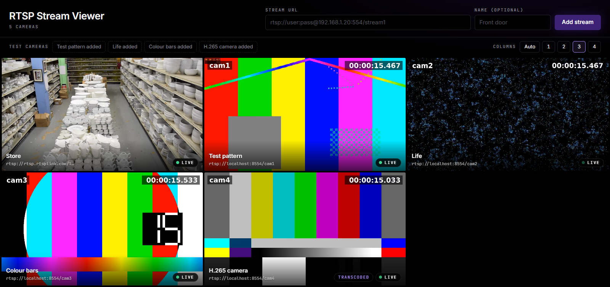

# RTSP Stream Viewer

Add RTSP camera URLs and watch them live in the browser, several at once in a grid.
Go backend with FFmpeg, React + TypeScript frontend, video over WebSockets.

**Live demo:** https://skylark-labs-task.vercel.app
(backend: https://skylark-labs-task-production.up.railway.app)

No login or credentials are needed. Click the **Test cameras** buttons to add the four bundled
test streams, or paste any public `rtsp://` URL.



## Features

- Add streams by URL (`rtsp://` or `rtsps://`, with optional `user:pass@`) and an optional name.
- Grid of live tiles: auto layout or a fixed 1–4 columns, works on phones.
- Per-tile play/pause, fullscreen and remove. Tiles scrolled off screen pause themselves and
  resume when visible again.
- Live status on every tile: connecting, live, reconnecting or error, with a readable message
  (bad credentials, camera unreachable, stream path not found, ...).
- Automatic recovery: the backend restarts FFmpeg with backoff, and the player reconnects on
  its own.
- H.264 cameras are passed through without re-encoding. Cameras that send H.265 (which most
  browsers can't play) are transcoded to H.264 automatically and tagged "Transcoded".
- Passwords and query strings (often access tokens) are masked in the UI, API responses and
  logs.
- Your wall of cameras is remembered in the browser across reloads.

## How it works

```
 Browser (React, Vercel)
   │  REST   POST/GET/DELETE /api/streams
   │  WS     /ws/{id}: JSON status + binary fMP4 segments
   ▼
 Go server (Railway, Docker)
   ├─ api      validates URLs, registers streams
   ├─ stream   one FFmpeg process per unique URL, restarted with backoff
   ├─ mp4      splits FFmpeg output into init + keyframe-aligned segments
   ├─ hub      fans one stream out to any number of viewers
   └─ ws       sends status, init and segments to each viewer
   │
   ▼  RTSP over TCP
 Camera, or the bundled MediaMTX test cameras
```

Browsers can't play RTSP, so the server converts it:

1. **FFmpeg** pulls the camera over RTSP/TCP and remuxes it to **fragmented MP4** on stdout,
   with `-c:v copy` for H.264, so nothing is re-encoded and CPU stays low.
2. A small **MP4 box parser** (`backend/internal/mp4`) cuts that byte stream into the init
   segment (`ftyp`+`moov`, cached for late joiners) and media segments (`moof`+`mdat`), each
   starting on a keyframe. It also reads the codec string (e.g. `avc1.4D401F`).
3. The **hub** gives each viewer a buffered queue. A new viewer gets the cached init segment and
   joins at the next keyframe. A slow viewer skips segments instead of slowing everyone else.
4. The **WebSocket** sends `{"type":"status"}` and `{"type":"init","codec":...}` as JSON text
   messages, and video as binary messages.
5. The browser feeds the segments to a `<video>` through **Media Source Extensions**, so the
   browser's own (hardware) decoder plays it. The player trims old buffer and jumps forward if it
   falls more than 2.5 s behind, so latency stays well under a second in practice.

### Scaling and performance

- **One FFmpeg per camera, shared by all viewers.** Ten people watching cam1 still run one
  FFmpeg.
- **Lazy start, idle stop.** FFmpeg starts when the first viewer connects and stops 30 s after
  the last one leaves, so registered but unwatched cameras cost nothing.
- **No re-encoding for H.264.** Only H.265 sources are transcoded (`libx264 ultrafast`, capped
  at 1280 px wide).
- **Limits.** At most 16 streams per server (`MAX_STREAMS`), request bodies and URLs are size
  capped.
- Measured locally: 9 streams in one browser all live, about 0.4 s behind the camera, FFmpeg
  using 23% of one CPU core in total (mostly the one H.265 transcode). All recovered within 5 s
  after the camera server was restarted.

To grow further, the stream manager could run on several servers, with each camera assigned to
one server (for example by hashing its URL) and a shared registry in Redis or a database.

### Error handling

- URLs are validated in the browser and again on the server (scheme, host, length, spaces).
- FFmpeg errors are turned into readable messages: bad credentials, camera unreachable, stream
  path not found, stream ended.
- A dropped camera goes to "reconnecting" and is retried with backoff (1 s doubling to 30 s).
  Errors that look permanent, like bad credentials, show as "error" but are still retried
  slowly, and the tile has a **Retry now** button.
- If the source restarts with a new codec, the server resends the init segment and the player
  resets its decoder.
- The player reconnects its WebSocket with backoff (1 s up to 10 s) if the server goes away.
- On shutdown (SIGTERM) the server stops every FFmpeg and closes viewer connections cleanly.

### Security

The deployed server fetches any URL a visitor gives it, so it blocks stream URLs that point at
private, loopback, link-local (including the cloud metadata address `169.254.169.254`) and other
internal addresses, checked after DNS resolution (`backend/internal/stream/guard.go`). The
bundled test cameras on `localhost:8554` are allowed through an allow list. The guard is off by
default for local development, so cameras on your own network work.

## Project layout

```
backend/           Go server
  cmd/server/      entry point, env config, graceful shutdown
  internal/api/    REST handlers, CORS
  internal/stream/ stream manager, FFmpeg runner, error classification, SSRF guard
  internal/mp4/    fragmented MP4 box parser
  internal/hub/    fan-out to viewers
  internal/ws/     WebSocket handler
frontend/          React + TypeScript + Vite + Tailwind CSS
  src/player/      MSE player for the WebSocket stream
  src/components/  stream tile, add form
streams/           MediaMTX test cameras (Dockerfile, clip generator, config)
deploy/            container entrypoint
Dockerfile         deployment image: Go server + FFmpeg + MediaMTX + test clips
docker-compose.yml test cameras for local development
railway.json       Railway build and health check settings
```

## Running locally

### Prerequisites

- Go 1.27+
- Node.js 22+ and npm
- FFmpeg on your `PATH` (`ffmpeg -version` should work)
- Docker, for the test cameras

### 1. Start the test cameras

```bash
docker compose up -d
```

This runs MediaMTX with four looping test cameras:

| URL                              | Video                               |
| -------------------------------- | ----------------------------------- |
| `rtsp://localhost:8554/cam1`     | H.264 test pattern                  |
| `rtsp://localhost:8554/cam2`     | H.264 animation                     |
| `rtsp://localhost:8554/cam3`     | H.264 colour bars                   |
| `rtsp://localhost:8554/cam4`     | H.265 colour bars (gets transcoded) |

Check one with `ffplay rtsp://localhost:8554/cam1` if you have ffplay.

### 2. Start the backend

```bash
cd backend
go run ./cmd/server
```

It listens on http://localhost:8080 (`curl localhost:8080/healthz` prints `ok`).

### 3. Start the frontend

```bash
cd frontend
npm install
npm run dev
```

Open http://localhost:5173. The Vite dev server proxies `/api` and `/ws` to the backend, so no
extra configuration is needed. Click the **Test cameras** buttons to add the streams.

Stop everything with Ctrl+C in each terminal and `docker compose down`.

### Alternative: the deployment image

The root `Dockerfile` builds the same image that runs on Railway, with the server, FFmpeg and the
test cameras in one container:

```bash
docker build -t rtsp-viewer .
docker run --rm -p 8080:8080 -e ALLOWED_ORIGINS=http://localhost:5173 rtsp-viewer
```

Then run the frontend as in step 3.

## Configuration

Backend (environment variables):

| Variable               | Default                                       | Purpose                                                             |
| ---------------------- | --------------------------------------------- | ------------------------------------------------------------------- |
| `PORT`                 | `8080`                                        | HTTP port                                                           |
| `ALLOWED_ORIGINS`      | `http://localhost:5173,http://127.0.0.1:5173` | Comma-separated frontend origins allowed by CORS and WebSocket (`*` for any) |
| `FFMPEG_PATH`          | `ffmpeg`                                      | FFmpeg binary                                                       |
| `MAX_STREAMS`          | `16`                                          | Maximum registered streams                                          |
| `IDLE_TIMEOUT_SECONDS` | `30`                                          | Stop FFmpeg this long after the last viewer leaves                  |
| `BLOCK_PRIVATE_URLS`   | `false` (`true` in the Docker image)          | Reject stream URLs that resolve to internal addresses               |
| `ALLOWED_STREAM_HOSTS` | `localhost:8554`                              | `host:port` list that skips that check                              |

Frontend (build time):

| Variable       | Default                  | Purpose                                                         |
| -------------- | ------------------------ | --------------------------------------------------------------- |
| `VITE_API_URL` | same origin              | Backend URL when it's hosted elsewhere, e.g. the Railway URL    |
| `VITE_WS_URL`  | derived from the API URL | Only needed if WebSockets use a different host                  |
| `BACKEND_URL`  | `http://localhost:8080`  | Dev server only: where `npm run dev` proxies `/api` and `/ws`   |

## Tests

From the repo root:

```bash
cd backend
go test ./...
cd ../frontend
npm test
```

- **Backend:** unit tests in every package: MP4 parsing and codec detection, hub fan-out and
  slow viewers, the stream lifecycle with a fake FFmpeg runner (lazy start, idle stop,
  reconnects, switching to transcoding), error classification,
  the REST API, the WebSocket protocol, URL validation and the SSRF guard.
- **Frontend:** Vitest tests for URL validation and masking, and for the MSE player with fake
  `MediaSource` and `WebSocket` objects (init handling, source restarts, following the live
  edge, skipping gaps, buffer trimming, pause/play, reconnecting with backoff).

## Deployment

- **Backend → Railway.** Railway builds the root `Dockerfile` (see `railway.json`, health check
  on `/healthz`). Variables: `PORT=8080`, `ALLOWED_ORIGINS=https://skylark-labs-task.vercel.app`.
  The image already turns on `BLOCK_PRIVATE_URLS`.
- **Frontend → Vercel.** Root directory `frontend`, Vite preset, and
  `VITE_API_URL=https://skylark-labs-task-production.up.railway.app`.

The backend can't run on Vercel because it needs long-lived WebSocket connections and FFmpeg
processes.

## Known limitations

- **No accounts.** Anyone with the link can add and remove streams. The server's stream list is
  shared, while each browser keeps its own wall.
- **Video only.** Audio is dropped.
- **Transcoding isn't capped.** Each H.265 camera costs real CPU; a production version would
  limit concurrent transcodes.
- **SSRF guard gaps.** It checks the address when a stream is added. It doesn't stop DNS
  rebinding (a name that resolves to a different address by the time FFmpeg connects) or an RTSP
  server redirecting FFmpeg to an internal host.
- **One server.** Streams live in memory, so a restart forgets the server's list (the browser
  re-registers its saved cameras when the page loads). See Scaling above for how to spread load.
- **Browser support.** Needs Media Source Extensions: current Chrome, Edge, Firefox and Safari
  (iOS 17.1+ through ManagedMediaSource).
- **Demo hosting.** The backend runs on a Railway trial, which ends around mid-November 2026.
